# agent-frontend · 校园二手集市前端

基于 **Vue 3 + Vite + Element Plus + Axios** 的校园二手交易平台前端，当前实现：

- 用户登录页（学号 + 密码校验、登录态持久化、登录后跳回原页面）
- 商品列表页（关键词搜索、价格区间筛选、分页、加载/空状态、图片兜底）
- 商品详情页（点击卡片进入，多图预览、商品信息、卖家信息、联系卖家入口）
- 发布商品页（表单校验、图片上传到 `/api/file/upload`、最多 5 张、**提交后进入待审核**）
- 私信聊天页（从商品详情“联系卖家”进入，历史记录 + WebSocket 实时收发 + 断线自动重连）
- 消息中心（会话列表、未读数红点、进入会话自动已读）
- 我的商品（按状态筛选、**编辑已发布商品**、一键标记已售出、返回主页）
- 管理员后台（商品审核、举报处理，仅 role=1 可见）
- 系统通知中心（审核结果、违规下架通知，未读角标、一键已读）
- 商品举报入口（详情页提交举报原因）
- 注册页（学号 / 昵称 / 密码，注册成功自动带学号回登录页）
- 个人中心（资料概览、头像上传、修改昵称、修改密码、常用入口）
- 浏览记录（后端 MySQL 存储，登录同账号可跨设备同步，可单条删除 / 清空）
- 管理员举报历史（待处理 / 已处理切换）
- Axios 统一封装：自动携带 `Authorization: Bearer <token>`，统一处理 401（清登录态并跳登录页）与业务错误

后端接口来自 Apifox 文档：<https://s.apifox.cn/471855be-9b0d-4551-bfc4-82013e230855>

## 界面预览

| 登录页 | 商品列表页 |
| --- | --- |
| 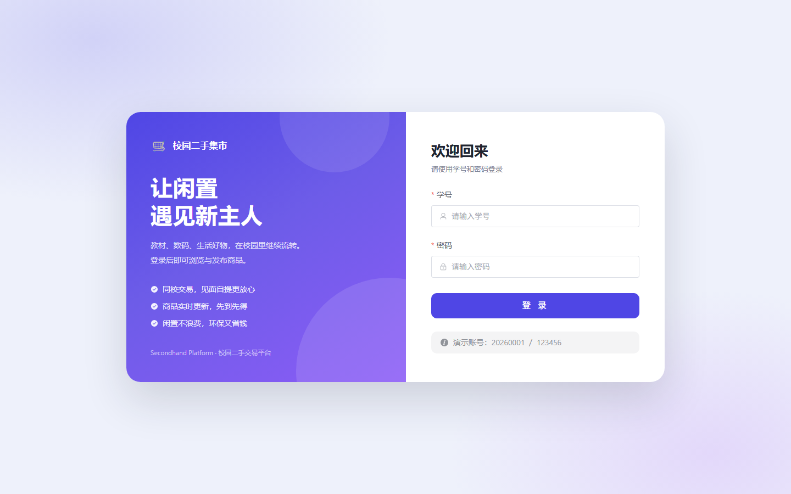 | 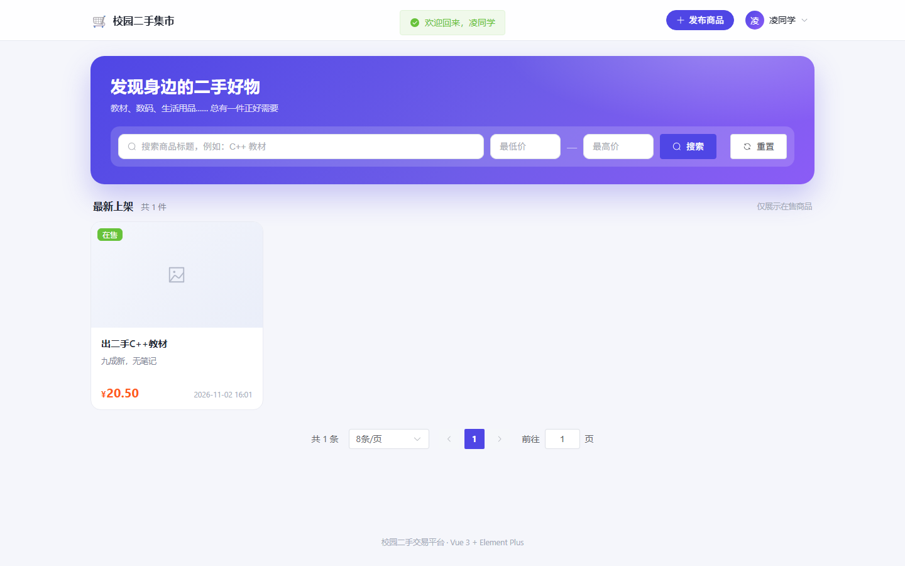 |

| 商品详情页 | 发布商品页 |
| --- | --- |
| 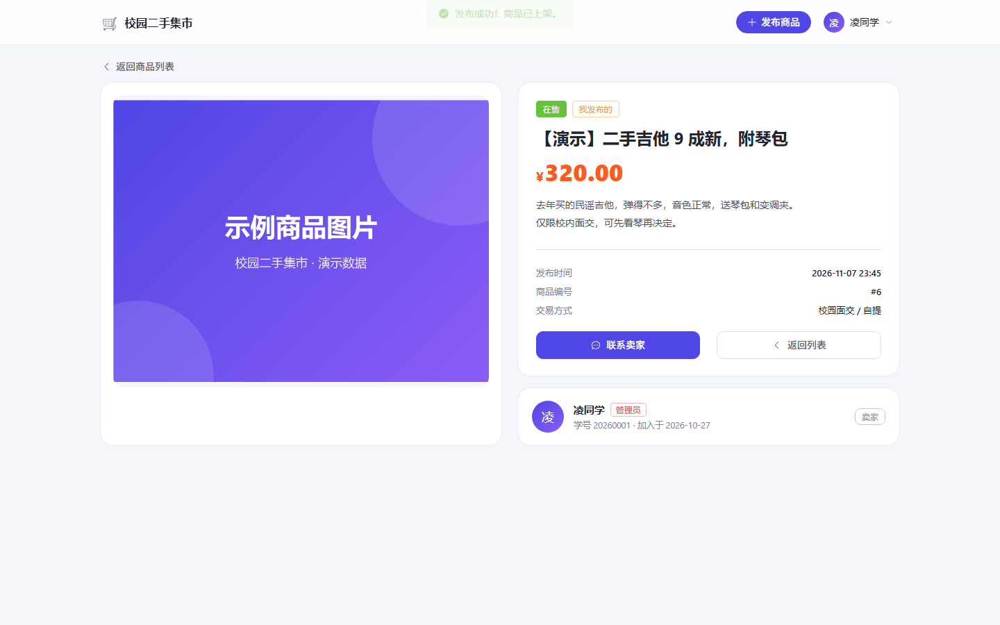 | 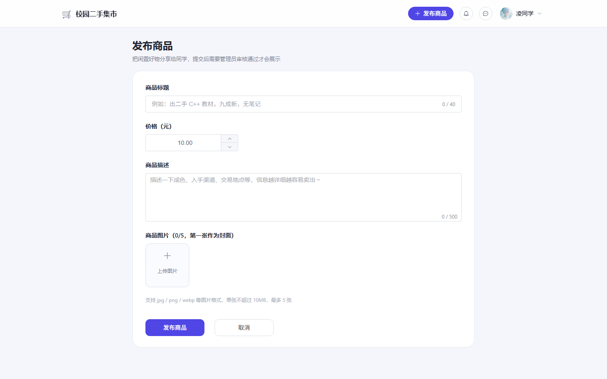 |

| 私信聊天页 | 消息中心 |
| --- | --- |
| 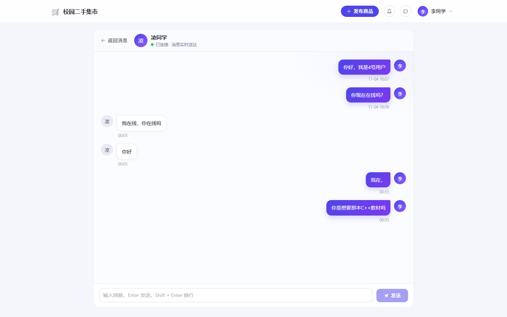 | 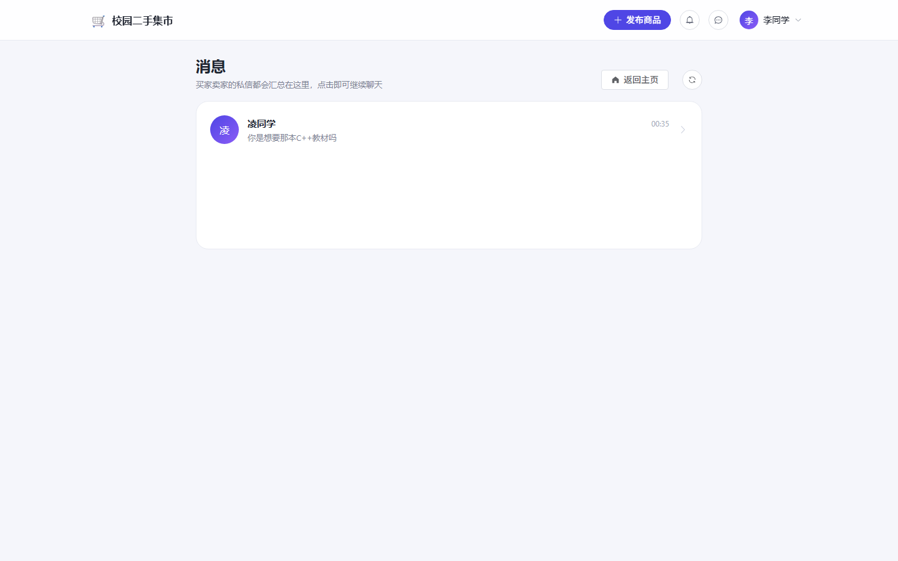 |

| 我的商品 |
| --- |
| 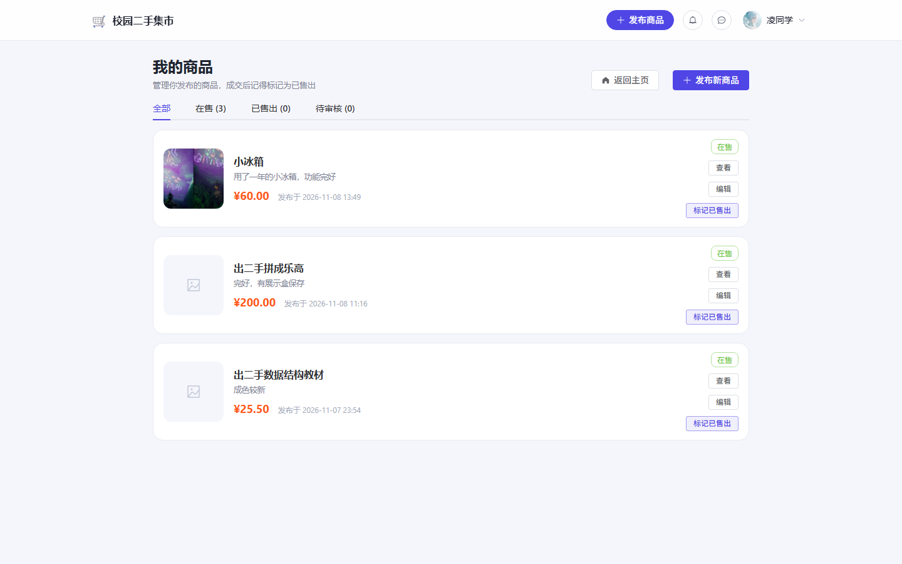 |

| 商品审核 | 举报处理 |
| --- | --- |
| 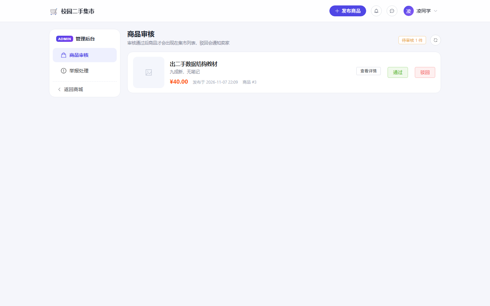 | 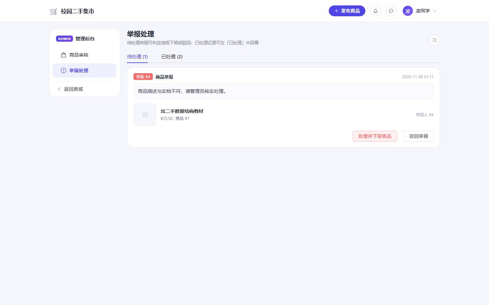 |

| 系统通知 |
| --- |
| 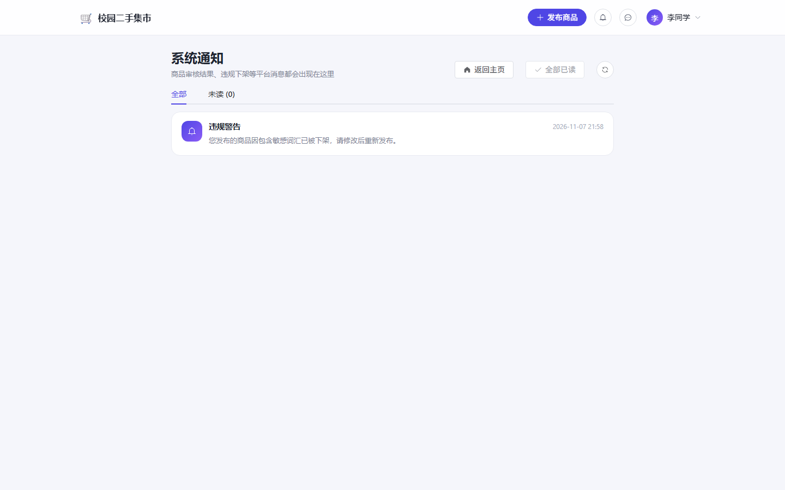 |

| 注册页 | 个人中心 |
| --- | --- |
| 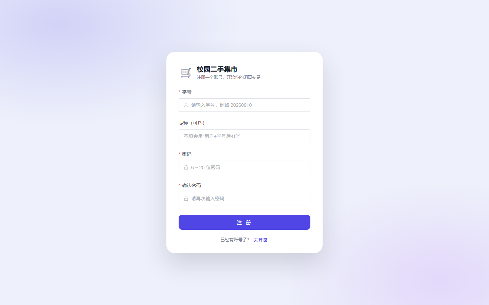 | 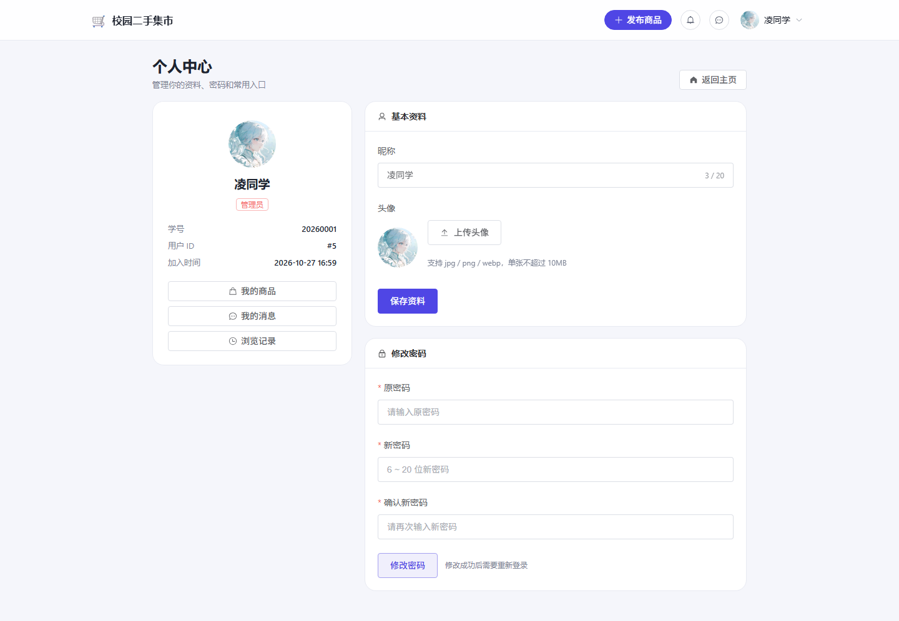 |

| 浏览记录 | 已处理举报 |
| --- | --- |
| 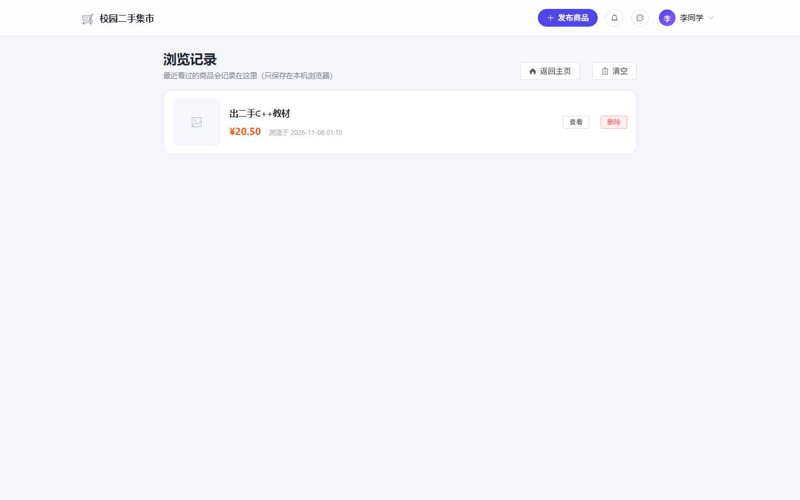 | 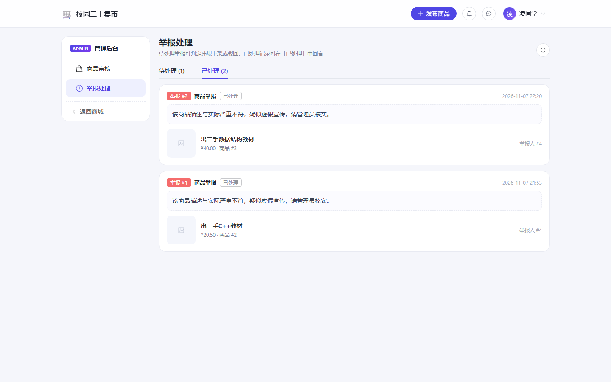 |

> 截图中的“演示”商品是联调时为验证上传/发布流程临时创建的，验证完已删除，不是数据库里的固定数据。

## 快速开始

需要 Node.js 18+（本机使用 Node 25 验证通过）。

```bash
cd agent-frontend
npm install
npm run dev
```

打开 <http://localhost:5173>，演示账号：

| 学号 | 密码 |
| --- | --- |
| 20260001 | 123456 |
| 20260004 | 123456 |

打包与本地预览：

```bash
npm run build
npm run preview
```

## 后端地址配置

| 文件 | 变量 | 作用 |
| --- | --- | --- |
| `vite.config.js` | `BACKEND_URL` | 开发代理目标，固定为 `http://8.138.25.66:8080` |
| `.env.development` | `VITE_USE_PROXY=true` | 开发时请求走 Vite 代理（同源，规避跨域） |
| `.env.production` | `VITE_API_BASE_URL` | 生产环境直连后端，默认 `http://8.138.25.66:8080` |

> **为什么要开发代理？**
> 后端目前没有返回 CORS 响应头（`Access-Control-Allow-Origin`），浏览器从 `localhost:5173` 直连 `8.138.25.66:8080` 会被跨域拦截。
> 开发环境通过 Vite 的 `server.proxy` 把 `/api`、`/images` 转发到后端，浏览器看到的是同源请求，因此可以正常联调。
>
> 如果希望**任何环境都能直连** `http://8.138.25.66:8080`，需要在后端加 CORS 配置（Spring Boot）：
>
> ```java
> @Bean
> CorsConfigurationSource corsConfigurationSource() {
>     CorsConfiguration config = new CorsConfiguration();
>     config.setAllowedOriginPatterns(List.of("*"));
>     config.setAllowedMethods(List.of("GET", "POST", "PUT", "DELETE", "OPTIONS"));
>     config.setAllowedHeaders(List.of("*"));
>     config.setAllowCredentials(true);
>     UrlBasedCorsConfigurationSource source = new UrlBasedCorsConfigurationSource();
>     source.registerCorsConfiguration("/**", config);
>     return source;
> }
> ```
>
> 并在 `SecurityFilterChain` 上开启 `.cors(Customizer.withDefaults())`，重新打包部署即可。
> 生产环境更推荐用 Nginx 把前端静态文件和 `/api` 放在同一个域名下，这样连 CORS 都不需要。

## 目录结构

```
agent-frontend
├── index.html
├── package.json
├── vite.config.js           # 别名 @、开发代理
├── .env.development         # 开发环境变量（走代理）
├── .env.production          # 生产环境变量（直连后端）
├── preview/                 # 页面截图
└── src
    ├── main.js              # 挂载 Vue / Element Plus / 图标 / 路由
    ├── App.vue
    ├── router/index.js      # 登录、列表、详情、发布 + 登录守卫
    ├── api
    │   ├── request.js       # axios 实例：Token 注入、401 处理、统一错误提示
    │   ├── user.js          # 登录、用户信息
    │   ├── product.js       # 列表、详情、发布
    │   ├── file.js          # 图片上传
    │   ├── message.js       # 聊天记录、会话列表、未读数、已读
    │   ├── notification.js  # 系统通知列表 / 已读
    │   ├── history.js       # 浏览记录（后端接口）
    │   ├── report.js        # 提交举报
    │   └── admin.js         # 管理员：待审核商品、审核、举报处理/历史
    ├── composables
    │   └── useChatSocket.js # WebSocket 连接 + 断线重连
    ├── stores
    │   └── user.js          # 全局用户状态（头像/昵称改动实时同步顶栏）
    ├── utils
    │   ├── auth.js          # token / 用户信息存取
    │   └── url.js           # 图片地址补全
    ├── components
    │   ├── AppHeader.vue    # 顶部导航（发布入口、通知/私信红点、用户菜单）
    │   └── ProductCard.vue  # 商品卡片（可点击进详情）
    ├── views
    │   ├── LoginView.vue
    │   ├── RegisterView.vue
    │   ├── ProfileView.vue
    │   ├── HistoryView.vue
    │   ├── ProductListView.vue
    │   ├── ProductDetailView.vue
    │   ├── PublishView.vue
    │   ├── ChatView.vue
    │   ├── MessagesView.vue
    │   ├── NotificationsView.vue
    │   ├── MyProductsView.vue
    │   └── admin
    │       ├── AdminLayout.vue
    │       ├── AdminProductsView.vue
    │       └── AdminReportsView.vue
    └── styles/index.css     # 主题变量与全局样式
```

## 接口对接

| 功能 | 方法 | 路径 | 说明 |
| --- | --- | --- | --- |
| 登录 | POST | `/api/user/login` | Body：`{ studentId, password }`，返回 `data: { token, userId, nickname }` |
| 注册 | POST | `/api/user/register` | Body：`{ studentId, password, nickname? }` |
| 修改资料 | PUT | `/api/user/updateInfo` | Body：`{ nickname, avatar }` |
| 修改密码 | PUT | `/api/user/updatePassword` | Body：`{ oldPassword, newPassword }`，成功后需重新登录 |
| 用户信息 | GET | `/api/user/info` | 需要 `Authorization`，用于刷新昵称、验证 Token |
| 商品列表 | GET | `/api/product/list` | 参数：`page`、`size`、`keyword`、`minPrice`、`maxPrice` |
| 商品详情 | GET | `/api/product/detail/{id}` | 需要 `Authorization`，返回 `data: { product, seller }` |
| 发布商品 | POST | `/api/product/publish` | 需要 `Authorization`，Body：`{ title, price, description, imageUrls }`，发布后 status=0 待审核 |
| 修改商品 | PUT | `/api/product/update/{id}` | 需要 `Authorization`，只能改自己的；修改后重新进入待审核 |
| 图片上传 | POST | `/api/file/upload` | 需要 `Authorization`，`multipart/form-data`，字段名 `file` |
| 聊天记录 | GET | `/api/message/history` | 需要 `Authorization`，参数 `friendId`，返回 Message 数组 |
| 会话列表 | GET | `/api/message/conversations` | 需要 `Authorization`，返回每个会话的最后一条消息与未读数 |
| 未读总数 | GET | `/api/message/unread-count` | 需要 `Authorization`，顶栏红点用 |
| 标记已读 | PUT | `/api/message/read` | 需要 `Authorization`，参数 `friendId` |
| 我的商品 | GET | `/api/product/my` | 需要 `Authorization`，返回我发布的全部商品 |
| 修改商品状态 | PUT | `/api/product/updateStatus/{id}` | 需要 `Authorization`，后端固定置为 2（已售出） |
| 提交举报 | POST | `/api/report/submit` | 需要 `Authorization`，Body：`{ targetType:1, targetId, reason }` |
| 系统通知 | GET | `/api/notification/list` | 需要 `Authorization`，返回我的通知列表 |
| 通知已读 | PUT | `/api/notification/read/{id}` | 需要 `Authorization`，只能改自己的通知 |
| 待审核商品 | GET | `/api/admin/product/pending` | 仅管理员（后端 AdminInterceptor 校验 role=1） |
| 审核商品 | PUT | `/api/admin/product/audit/{id}?pass=1` | `pass=1` 通过，`pass=0` 驳回并下架 |
| 待处理举报 | GET | `/api/admin/report/pending` | 仅管理员 |
| 已处理举报 | GET | `/api/admin/report/handled` | 仅管理员，举报历史列表 |
| 记录浏览 | POST | `/api/history/record?productId=` | 需要 `Authorization`，同一商品只更新时间 |
| 浏览记录 | GET | `/api/history/list` | 需要 `Authorization`，返回最近 50 条（带商品信息） |
| 删除浏览记录 | DELETE | `/api/history/{id}` | 需要 `Authorization`，只能删自己的 |
| 清空浏览记录 | DELETE | `/api/history/clear` | 需要 `Authorization` |
| 处理举报 | PUT | `/api/admin/report/handle/{reportId}?action=1` | `action=1` 判定违规：下架商品 + 通知卖家；`action=0` 驳回举报：商品保持原状态、不发通知 |

后端统一响应格式为 `{ code, message, data }`：`code === 200` 视为成功，其余情况由拦截器弹出 `message`。

> ⚠️ **图片上传接口的返回比较特殊**：后端 `Result.success(imageUrl)` 匹配到了 `success(String message)` 重载，
> 所以图片地址实际返回在 **`message`** 字段里，`data` 是 `null`：
>
> ```json
> { "code": 200, "data": null, "message": "/images/xxxx.png" }
> ```
>
> `src/api/file.js` 里已经做了兼容（`res.data || res.message`），不要想当然按 `data` 取。

## WebSocket 私信联调说明

### 连接地址

```
ws://8.138.25.66:8080/ws/chat?userId=<当前登录用户ID>
```

- 地址来自 `.env.development` / `.env.production` 的 `VITE_WS_BASE_URL`
- `userId` 取登录后存在 `localStorage` 里的 `sp_user.userId`（例如 20260001 登录后是 5）
- 这个握手接口只从 query 里取 `userId`，不校验 `Authorization`；后端 `WebSocketConfig` 已 `setAllowedOrigins("*")`，所以浏览器/本地开发都能直连，不受 CORS 限制

### 消息格式

**发送**（前端自动拼接 `接收者ID:消息内容`）：

```
5:你好，书还在吗
```

后端 `split(":", 2)` 解析，所以消息正文里可以继续出现冒号。

**接收**（后端推送 JSON，带发送者 ID）：

```json
{
  "type": "message",
  "messageId": 12,
  "senderId": 5,
  "receiverId": 4,
  "content": "在的，你什么时候方便面交？",
  "createTime": "2026-11-08T00:19:00"
}
```

前端处理：

- 用 `senderId` 判断这条消息是不是**当前聊天对象**发来的：不是当前会话的消息不会渲染到当前聊天框（顶栏未读数会提示）；
- 是当前会话，则追加成对方气泡，并调用「标记已读」接口。

> 兼容说明：如果后端还没更新（推送纯文本 `收到新消息：内容`），前端也能识别，按当前会话渲染。

### 历史记录

```
GET /api/message/history?friendId=4      (需要 Authorization)
```

返回 `data` 为 `Message` 数组（`senderId`、`receiverId`、`content`、`createTime`、`isRead`），
前端按 `senderId === 当前用户ID` 判断左右气泡，进入聊天页时调用一次。

### 会话列表与未读数

| 接口 | 说明 |
| --- | --- |
| `GET /api/message/conversations` | 把和我聊过天的人聚合成会话，返回 `friendId`、`friendNickname`、`lastContent`、`lastTime`、`unreadCount` |
| `GET /api/message/unread-count` | 我的未读消息总数，顶栏消息按钮红点用（前端每 20 秒轮询一次，切换路由时也会刷新） |
| `PUT /api/message/read?friendId=4` | 进入会话后，把对方发来的未读消息置为已读 |

对应的后端改动（本次一起提交）：

- `MessageController` 新增 `conversations`、`unread-count`、`read` 三个接口；
- `ChatWebSocketHandler` 推送从纯文本改成 JSON（带 `senderId`）。

这两处需要重新打包部署后端才会生效，见下方「后端部署提醒」。

### 断线重连策略

相关逻辑在 [useChatSocket.js](src/composables/useChatSocket.js)：

- `onclose` → 指数退避重连：1s → 2s → 4s → 8s，最长 15s 一次；
- 监听浏览器 `online` 事件 → 网络恢复立即重连，不等退避；
- 离开聊天页 / 切换聊天对象 → 关闭旧连接，按新的 `friendId` 重新建立；
- 重连成功 → 再拉一次历史记录，补齐断线期间对方发来的消息；
- 顶部状态点实时显示：绿色“已连接”、橙色“连接中/重连中”、红色“未连接”，彻底断开时会出现“重新连接”按钮。

### 联调自测方法

1. 开两个浏览器（或普通窗口 + 无痕窗口），分别登录 `20260001`（userId=5）和 `20260004`（userId=4）；
2. A 打开商品详情点「联系卖家」，进入与 B 的聊天页；
3. B 用浏览器控制台或在线 WebSocket 工具连 `ws://8.138.25.66:8080/ws/chat?userId=4`，发送 `5:测试消息`；
4. A 的聊天页应立即出现气泡；再在 A 页面回复，B 的连接会收到 JSON：`{"type":"message","senderId":5,...}`；
5. 打开顶栏的消息按钮（或直接访问 `/messages`），能看到会话列表和未读数；点进会话后未读清零；
6. B 给 A 发消息时 A 不在聊天页，A 顶栏红点会增加（最多 20 秒内刷新一次）。

### 已知限制（后端当前实现）

- `WebSocketSessionManager` 是 `Map<userId, session>`：同一账号开多个标签页，只有最后一个连接能收到实时推送；
- 只支持单聊，没有群聊、消息撤回、已读回执；
- 未读数依赖前端轮询（20 秒）+ 进入会话清除，不是服务端主动推；
- 离线消息只入库不推送，需要用户进入会话时用 history 接口补齐（本项目已实现）。

## 前端部署（Nginx 同源）

生产环境不再使用 Vite 的开发代理，改成 **Nginx 托管 dist + 反向代理后端**，前后端同源，不需要给后端加 CORS。

### 1. 生产环境变量

`.env.production` 已配置为同源：

```ini
VITE_API_BASE_URL=/
VITE_WS_BASE_URL=ws://8.138.25.66
```

- `VITE_API_BASE_URL=/`：接口请求变成 `/api/...`，由 Nginx 转发到 8080；
- `VITE_WS_BASE_URL`：HTTP 站点用 `ws://8.138.25.66`，以后上 HTTPS 要改成 `wss://你的域名`；
- 这两个值在**打包时**写进代码，改完必须重新 `npm run build`。

### 2. 本地打包并上传

```powershell
cd agent-frontend
npm install
npm run build
```

把 `dist/` 里的内容上传到服务器 `/www/wwwroot/secondhand-frontend/`，确保 `index.html` 就在这一层（不要多套一层 dist）。

### 3. 配置 Nginx

完整配置模板见 [deploy/nginx.conf](deploy/nginx.conf)，核心是四段：

- `location /` → `try_files $uri $uri/ /index.html`（history 路由刷新不 404）；
- `location /api/` → 反代 `127.0.0.1:8080`；
- `location /images/` → 反代 8080（或 `alias` 到上传目录）；
- `location /ws/` → 反代 8080 并带 `Upgrade` / `Connection` 头（聊天必需）；
- 别忘了 `client_max_body_size 50m`（上传图片）。

```bash
nginx -t
nginx -s reload
```

### 4. 上线检查

- 直接访问 `http://8.138.25.66/` 能打开并登录；
- 刷新 `/products`、`/profile`、`/products/2` 不 404；
- 商品图片正常显示（`/images` 代理且后端上传目录已挂载）；
- 上传图片不报 413；
- 私信页显示「已连接 · 消息实时送达」；
- 改头像后顶栏同步、刷新仍在。

> 常见问题：白屏 404 多半是 dist 多套了一层目录；接口跨域说明 `.env.production` 没改成 `/`；上传 413 是 Nginx 包体限制；聊天重连是 `/ws/` 少了 Upgrade 头。


### 图片上传目录（重要）

- 后端 `FileController` 和 `WebMvcConfig` 现在共用配置项 `file.upload-dir`，默认 `/www/wwwroot/secondhand-uploads/`，可用环境变量 `FILE_UPLOAD_DIR` 覆盖；
- 如果后端跑在 Docker 里，**图片写进的是容器内部**的 `/www/wwwroot/secondhand-uploads/`，宿主机上这个目录是空的；容器 `docker rm -f` 重建后图片就会丢（实测旧的图片地址现在返回的不是图片，正是这个原因）；
- 解决：把宿主机目录挂载进容器，并保证可写：

```bash
mkdir -p /www/wwwroot/secondhand-uploads
chmod 755 /www/wwwroot/secondhand-uploads
docker run -d --name secondhand-platform -p 8080:8080 \
  -v /www/wwwroot/secondhand-uploads:/www/wwwroot/secondhand-uploads \
  secondhand-platform
```

以后重建容器时也要带上这个 `-v`。

### 后端部署提醒

本次联调新增/修改了后端代码：

- `MessageController`：会话列表、未读数、标记已读；
- `ChatWebSocketHandler`：推送改成带 `senderId` 的 JSON；
- `AdminController`：举报处理支持 `action=0/1`（驳回/下架）、审核和下架后清商品列表缓存、新增「已处理举报」接口 `/api/admin/report/handled`；
- `ProductController`：发布商品改为进入待审核（status=0），新增「修改自己的商品」接口 `/api/product/update/{id}`；
- 新增 `BrowseHistory` 实体 / Mapper / `BrowseHistoryController`：浏览记录跨设备同步（`/api/history/**`）；
- `FileController` / `WebMvcConfig`：上传目录改为可配置的 `file.upload-dir`；
- 新增 `ProductCacheUtils`：统一清 `product:list:*` 缓存。

数据库需要多一张表（已在本项目云端库执行过，脚本在 [sql/browse_history.sql](../secondhand-platform/sql/browse_history.sql)）：

```bash
mysql -u secondhand_db -p secondhand_db < sql/browse_history.sql
```

需要重新打包并重启服务器上的服务：

```bash
# 1. 本地打包
./mvnw clean package -DskipTests
# 产物：target/secondhand-platform-0.0.1-SNAPSHOT.jar

# 2. 上传 jar 到服务器项目目录后（Docker 部署方式）
docker build -t secondhand-platform .
docker rm -f secondhand-platform
docker run -d --name secondhand-platform -p 8080:8080 secondhand-platform
```

如果服务器不是 Docker 部署，直接替换 jar 后重启 `java -jar` 进程即可。

> 注意：后端没更新时，聊天本身还能用（前端兼容旧协议），但「消息中心、未读数、标记已读、我的商品」这些新接口会返回 404；管理员「驳回举报」也会被旧后端当成下架处理；「已处理举报」Tab 会因 `/api/admin/report/handled` 不存在而报 404。请务必先部署新后端再试用这些功能。

## Token 与 401 处理逻辑

`src/api/request.js` 中：

1. **请求拦截器**：从 `localStorage` 取 `sp_token`，存在则加上 `Authorization: Bearer <token>`。
2. **响应拦截器**：
   - HTTP 401 → 清除本地登录态、提示“登录已过期，请重新登录”、跳转 `/login?redirect=当前地址`；
   - 业务 `code !== 200` → 弹出后端返回的 `message` 并 reject；
   - 403 / 404 / 5xx / 超时 / 断网 → 分别给出中文提示。
3. **路由守卫**：`/products`、`/products/:id`、`/publish`、`/chat/:friendId`、`/messages`、`/notifications`、`/my-products`、`/admin/**` 都需要登录；`/admin/**` 还会额外校验 `role === 1`。

## 页面细节

**登录页**：左侧品牌区 + 右侧表单，学号/密码前端校验，回车提交，按钮 loading，登录失败提示来自后端（如“密码错误”）；底部可跳转注册页，注册成功回来会自动带上学号。

**注册页** `/register`：学号（4~20 位）、可选昵称、密码（6~20 位）、确认密码（一致性校验）；提交成功后提示后端 `message` 并跳回登录页。

**个人中心** `/profile`：
- 左侧资料卡：头像（昵称首字或上传的图片）、昵称、角色标签（管理员/普通用户）、学号、用户 ID、加入时间，以及「我的商品 / 我的消息 / 浏览记录」快捷入口；
- 右侧「基本资料」：**头像上传**（调用 `/api/file/upload`，上传成功直接保存到后端，换设备也能看到），**顶栏头像会实时同步**；修改昵称（≤20 字）；
- 右侧「修改密码」：原密码 + 新密码 + 确认密码校验，修改成功后清除登录态、跳回登录页；
- 顶部有「返回主页」按钮。

**浏览记录** `/history`：
- 进入商品详情页时调用 `POST /api/history/record` 记录（后端按 user_id + product_id 去重，只更新时间）；
- 列表从 `GET /api/history/list` 拉取最近 50 条，展示缩略图、标题、价格、浏览时间，可「查看」或「删除」，支持一键清空；
- 数据存 MySQL 的 `browse_history` 表，同一账号换设备登录也能看到。

**商品列表页**：顶部栏展示昵称头像、发布入口、退出登录；搜索区支持关键词、价格区间；卡片悬浮显示“查看详情”，点击进入详情页；分页支持每页 8/12/20/40 条。

**商品详情页**：
- 左侧主图 + 缩略图切换（多图时），图片加载失败/无图有兜底；
- 右侧标题、价格、状态标签（在售/已售出/待审核）、描述、发布时间、商品编号、交易方式；
- “我发布的”标记（当前登录用户 == 商品 `userId` 时显示）；
- 卖家卡片：头像（昵称首字）、昵称、学号、加入时间、管理员标记；
- “联系卖家”跳转到与卖家的私信页（自己发布的商品会提示不能和自己聊天）；
- 从「我的商品」进入时会带 `from=my-products`，返回按钮显示「返回我的商品」；
- 商品不存在时展示 `el-result` 引导返回列表。

**发布商品页**：
- 标题（2~40 字）、价格（>0，两位小数）、描述（最多 500 字）均有校验；
- 图片上传：最多 5 张、单张 ≤10MB、仅图片格式，上传成功即时显示缩略图、可删除，第一张为封面；
- 上传中会禁用提交按钮，避免图片还没传完就发布；
- **提交后商品进入待审核（status=0）**，提示「已提交审核」并跳转到「我的商品」查看状态；
- `/publish/:id` 是**编辑模式**：自动回填商品信息，保存后重新进入待审核。

**私信聊天页** `/chat/:friendId`：
- 从商品详情页「联系卖家」或消息中心进入，对方昵称通过 query 带过来；
- 进入即加载历史记录并建立 WebSocket，消息按自己/对方分别左右气泡显示，带时间；
- 输入框支持 Enter 发送、Shift + Enter 换行，发送后立刻上屏；
- 对方消息通过 WebSocket 实时追加并自动滚到底部（用 `senderId` 区分会话）；
- 进入会话自动标记已读；
- 顶部显示连接状态，断线自动重连（详见下方 WebSocket 联调说明）；
- 左上角有「返回消息」按钮，点击回到 `/messages` 消息中心；
- 不能和自己聊天（自己发布的商品会给出提示）。

**消息中心** `/messages`：
- 会话列表按最后聊天时间倒序，显示对方昵称、最后一条消息、时间、未读数气泡；
- 顶栏消息按钮带未读红点，点击进入消息中心；
- 点击会话进入聊天页，进入后未读清零；
- 顶部有「返回主页」按钮。
- 空状态引导去商品列表。

**我的商品** `/my-products`：
- 顶栏用户菜单「我的商品」进入，页面右上角有「返回主页」；
- Tab 按状态区分全部 / 在售 / 已售出 / 待审核，并显示数量；
- 每行展示缩略图、标题、描述、价格、发布时间、状态标签；
- 在售/待审核商品可点「编辑」进入编辑页，保存后重新审核；
- 在售商品可点「标记已售出」（二次确认），成功后状态即时变更，并提示后端返回的 `message`；
- 点「查看」进入详情会带 `from=my-products`，详情页的返回按钮会回到「我的商品」；
- 空状态引导去发布商品。

**管理员后台** `/admin`（仅 `role === 1` 可见可进）：

- 顶栏用户菜单出现「管理员后台」入口；直接访问 `/admin` 时路由守卫会调用 `/api/user/info` 校验角色，非管理员会被拦回商品列表；
- 左侧菜单：商品审核 / 举报处理；
- **商品审核**：列出 `status = 0` 的商品（图片、标题、描述、价格、发布时间、商品编号），**点击缩略图、标题或「查看详情」会跳转到商品详情页**；可「通过」或「驳回」，二次确认后调用审核接口，成功后从列表移除，后端自动给卖家发系统通知，并立即清掉商品列表缓存（审核通过的商品马上能在列表看到）；
- **举报处理**：Tab 切换「待处理 / 已处理」，列表展示举报原因、举报人 ID、举报时间，并额外调用商品详情接口补出被举报商品的标题/图片/价格（点击也能进详情）。待处理举报有两种处理方式：
  - **处理并下架商品**：判定违规 → 商品置为违规下架（status=3）+ 给卖家发系统通知 + 清列表缓存；
  - **驳回举报**：认定举报不成立 → 只把举报标记为已处理，商品保持原状态，**不会给卖家发任何通知**。
  - 处理完后记录会移动到「已处理」Tab，可在历史里回看。

> 通知时机说明：提交举报本身不会通知卖家；只有管理员真的点了「处理并下架商品」才会生成「商品违规下架通知」。如果卖家在举报处理前就收到了通知，那多半是更早版本遗留的数据（例如本文档截图里那条 2026-11-07 的「违规警告」），可以到数据库 `notification` 表按 id 清理。

**系统通知** `/notifications`：
- 顶栏铃铛入口，未读数量角标（每 20 秒轮询 + 切换路由刷新）；
- Tab 区分全部 / 未读，展示标题、内容、时间、未读圆点；
- 点击某条通知标记已读，「全部已读」一键清空未读；顶部有「返回主页」按钮；
- 管理员审核通过/驳回、处理举报后，卖家会在这里收到通知。

**商品举报**：详情页对非自己发布的商品显示「举报」按钮，弹窗填写 5~200 字原因，调用 `POST /api/report/submit` 提交。

> 管理员账号：`20260001 / 123456`（数据库 `sys_user.role = 1`）；`20260004 / 123456` 是普通用户。

## 后续可扩展

- 商品分类筛选（后端已支持 `categoryId`，需要数据里有分类值）
- 管理员数据看板（用户数、商品数、举报统计）
- 服务端主动推送未读数 / 多端在线（当前 SessionManager 单连接）
